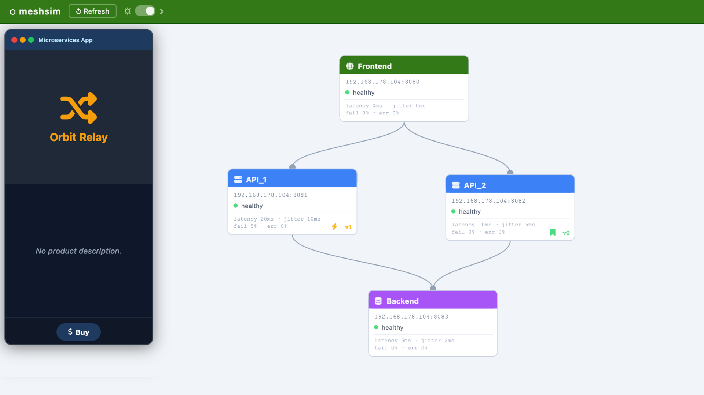

# meshsim

**meshsim** is a lightweight Go tool that simulates multi-tier service mesh topologies for demos,
teaching, and observability experiments. Launch multiple instances simultaneously — each configured
with a YAML file — and watch a live network diagram update in your browser as services call each
other, latency compounds, and failures propagate through the topology.



*The screenshot shows the microservices scenario: Frontend → API_1 (v1, 20 ms, 5% failure) + API_2 (v2, 10 ms) → Backend.*

---

## ✨ Features

- **Live topology graph** — pan, zoom, and drag nodes; auto-refreshes on a configurable timer
- **QoS simulation** — inject latency, jitter, failure rates, and upstream error rates per service
- **WebApp overlay** — a fake shop window with a Buy button, product display, quote, and counter
- **Health propagation** — `/health` cascades through the upstream chain
- **Round-robin routing** — built-in load-balancer mode (`round_robin: true`)
- **Version tags** — badge nodes with version labels for canary and blue-green demos
- **Self-contained binary** — the UI is embedded; no external file dependencies at runtime
- **Cross-platform** — pre-built binaries for macOS, Linux, and Windows

---

## Quick start

```sh
# Clone
git clone https://github.com/YOUR_ORG/meshsim.git
cd meshsim

# Build (requires Go 1.22+)
make build

# Launch the interactive scenario menu
./run.sh

# Then open the printed URL, e.g.:
open http://localhost:8080/ui
```

Or download a pre-built binary from the [latest release](https://github.com/YOUR_ORG/meshsim/releases/latest) — no Go installation required.

---

## Documentation

| Document | Description |
|---|---|
| [Getting Started](docs/getting-started.md) | Installation (binaries + source), quick start, CLI flags, Makefile reference, Docker |
| [Scenarios](docs/scenarios.md) | All six built-in scenarios with topology diagrams and demo instructions |
| [Creating Scenarios](docs/creating-scenarios.md) | Step-by-step guide to building custom topologies |
| [Configuration Reference](docs/configuration.md) | Full YAML schema with annotated examples |
| [UI Guide](docs/ui-guide.md) | Annotated walkthrough of the browser interface |
| [QoS Guide](docs/qos-guide.md) | Latency, jitter, failure rate, and error rate explained |
| [HTTP API Reference](docs/api-reference.md) | All endpoints with request/response examples and `curl` snippets |
| [Icons Reference](docs/Icons.md) | All supported Font Awesome icon names |
| [Release Process](docs/releasing.md) | How versions are tracked and binaries are published by CI |
| [Consul Integration](docs/consul-integration.md) | Using meshsim as a workload for Consul service mesh demos |

---

## Built-in scenarios

| Scenario | Instances | Ports | Highlights |
|---|---|---|---|
| `monolith` | 1 | 8080 | Single-service baseline with all features |
| `two-tier` | 2 | 8080–8081 | Simple frontend → backend split |
| `three-tier` | 3 | 8080–8082 | Classic web → app → data tiers |
| `microservices` | 5 | 8080–8084 | Parallel fan-out across leaf services |
| `replication` | 7 | 8080–8086 | Load balancer + two full replica stacks |
| `chaos` | 3 | 8080–8082 | 30% failure rate on AppLogic, 200 ms slow Backend |

Run any scenario:

```sh
./run.sh
```

---

## CLI flags

| Flag | Default | Description |
|---|---|---|
| `--config <path>` | `config.yaml` | Path to the YAML config file |
| `--quotes-file <path>` | — | Override `quotes_file`; also enables quotes |
| `--products-file <path>` | — | Override `products_file`; also enables products |
| `--counter` | `false` | Force-enable the in-memory counter |

---

## HTTP API

| Method / path | Description |
|---|---|
| `GET /` | Returns the recursive topology JSON (applies QoS, fans out to upstreams) |
| `GET /ui` | Browser UI (live topology diagram) |
| `GET /health` | `{"status":"ok"}` or `{"status":"degraded"}` with cascading upstream check |
| `GET /count/get` | Current counter value for this instance |
| `POST /count/add` | Increment counter (fans out if this instance does not own one) |

Full details in the [HTTP API Reference](docs/api-reference.md).

---

## Minimal YAML config

```yaml
name: "My Service"
color: "#3b82f6"
icon: "fa-server"
port: 8080
upstreams:
  - name: "Backend"
    address: "localhost"
    port: 8081
qos:
  latency_ms: 20
  jitter_ms: 10
  failure_rate: 0.05
  error_rate: 0.0
```

Full schema in the [Configuration Reference](docs/configuration.md).

---

## Building

| Command | Action |
|---|---|
| `make build` | Compile for the current platform |
| `make dist` | Cross-compile for Linux / macOS / Windows × amd64 / arm64 |
| `make check` | Run `gofmt` + `go vet` |
| `make clean` | Remove the binary and `dist/` |

Requires **Go 1.22+**. The only external dependency is `gopkg.in/yaml.v3`.

---

## Limitations

- No cycle detection — keep topologies acyclic (A → B → A recurses until timeout).
- No TLS or authentication on any endpoint.
- Counter and round-robin state are in-memory only; both reset on process restart.
- Font Awesome icons are loaded from a CDN by the browser (UI is not fully offline).

---

## Future work

- `/metrics` endpoint (Prometheus-compatible)
- Cycle detection via an `X-Visited-Nodes` propagation header
- `docker-compose.yml` per scenario
- `--version` flag
- Automated tests for config loading and QoS logic

---

## License

See [LICENSE](LICENSE) for details.
