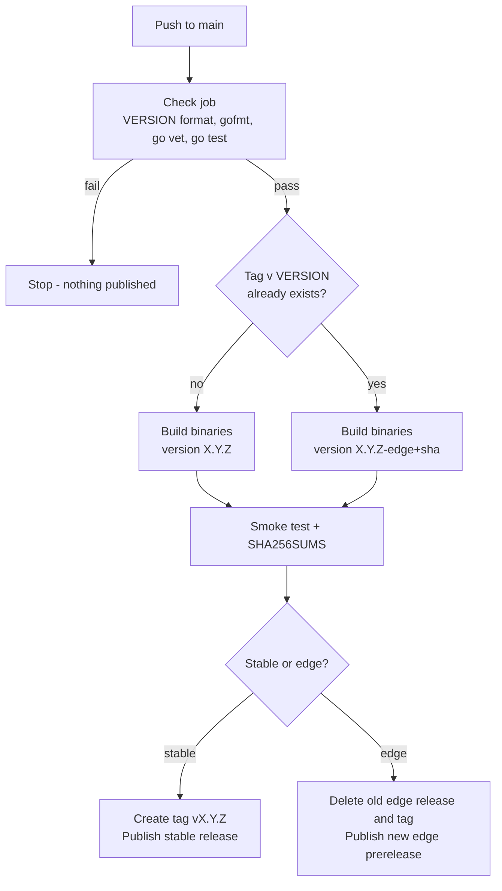

# Release Process

meshsim binaries are built and published automatically by GitHub Actions on every change to the
`main` branch. This document explains how versions are tracked, what the pipeline does, and how to
cut a new release.

The workflow lives in [`.github/workflows/release.yml`](../.github/workflows/release.yml).

---

## Overview

| Event | Checks | Result |
|---|---|---|
| Pull request to `main` | ✅ run | Nothing is published |
| Push to `main`, **`VERSION` is new** (no `v<VERSION>` tag yet) | ✅ run | **Stable release** `v<VERSION>` |
| Push to `main`, **`VERSION` unchanged** (tag `v<VERSION>` already exists) | ✅ run | **Rolling prerelease** `edge` (replaced) |
| Manual run (`workflow_dispatch`) | ✅ run | Same as a push when started on `main` |



---

## Version tracking

The single source of truth for the release version is the [`VERSION`](../VERSION) file at the
repository root. It contains one line in `MAJOR.MINOR.PATCH` format (no `v` prefix), for example:

```
0.1.0
```

Rules:

- The version follows [Semantic Versioning](https://semver.org/). Use patch for fixes, minor for
  backwards-compatible features, and major for breaking changes (for example, an incompatible YAML
  config change).
- The Git tag for a release is always `v` + the contents of `VERSION` (`0.1.0` → `v0.1.0`).
- CI rejects any `VERSION` that is not a plain `MAJOR.MINOR.PATCH` string.
- The version is compiled into the binary with `-ldflags "-X main.Version=..."` and shows up in
  every log line prefix, for example `[meshsim 0.1.0]`.

| Build | Version reported by the binary |
|---|---|
| Stable release | `0.2.0` |
| `edge` prerelease | `0.2.0-edge+a1b2c3d` (the `VERSION` value plus the short commit SHA) |
| Local `make build` | `git describe --tags --always --dirty` (or `dev` without Git) |

---

## Releasing a new version

1. Create a branch and bump the number in [`VERSION`](../VERSION):

   ```sh
   echo "0.2.0" > VERSION
   git checkout -b release-0.2.0
   git commit -am "Release 0.2.0"
   git push -u origin release-0.2.0
   ```

2. Open a pull request. CI runs the checks (including `VERSION` validation).
3. Merge the pull request into `main`.
4. The push to `main` triggers the workflow. Because `v0.2.0` does not exist yet, it builds the
   binaries, creates the tag `v0.2.0` on the merge commit, and publishes a GitHub Release with
   auto-generated notes (merged PRs and contributors since the previous release).

Every other merge to `main` leaves `VERSION` untouched and only refreshes the `edge` prerelease.

> **Do not bump `VERSION` and push tags by hand.** The workflow creates the tag. A tag that already
> exists makes the workflow treat further pushes as `edge` builds.

---

## What each run does

### `check` job (pull requests and pushes)

1. Validates the `VERSION` file format.
2. Fails if any Go file is not `gofmt`-formatted (`gofmt -l .`).
3. Runs `go vet ./...`.
4. Runs `go test ./...`. The repository has no tests yet; this step starts to matter as soon as
   test files are added.

### `release` job (pushes to `main` only, after `check` passes)

1. Checks out the full history and tags, then compares `VERSION` with the existing tags to decide
   between a stable and an `edge` release.
2. Runs `make dist VERSION=<computed version>` with `CGO_ENABLED=0`, producing static binaries:

   | File | Platform |
   |---|---|
   | `meshsim-linux-amd64` | Linux x86-64 |
   | `meshsim-linux-arm64` | Linux ARM64 |
   | `meshsim-darwin-amd64` | macOS Intel |
   | `meshsim-darwin-arm64` | macOS Apple Silicon |
   | `meshsim-windows-amd64.exe` | Windows x86-64 |

3. Smoke-tests the Linux amd64 binary: starts the `monolith` scenario, waits for `/health` to
   return success, and verifies that the log prefix contains the expected version string. A broken
   build is never published.
4. Writes `SHA256SUMS` for all binaries.
5. Publishes the release with the GitHub CLI (`gh`). No third-party release actions are used.

The `release` job has `contents: write` permission. The `check` job and pull requests only have
read access.

---

## Release types

### Stable release (`v<VERSION>`)

- Created once per `VERSION` value, on the commit that first introduces it.
- Immutable by convention: it is never rebuilt or overwritten.
- Marked as the repository's **Latest** release, so
  `https://github.com/YOUR_ORG/meshsim/releases/latest` always points to it.

### `edge` prerelease

- A single, moving prerelease. On every push to `main` the previous `edge` release and tag are
  deleted and recreated for the new commit, so there is no history clutter.
- Marked as a **prerelease** and never as Latest.
- Use it to try the newest `main` before a version is cut. Do not rely on it for reproducible
  setups.

---

## Downloading and verifying binaries

Latest stable release:

```sh
curl -L https://github.com/YOUR_ORG/meshsim/releases/latest/download/meshsim-linux-amd64 \
     -o meshsim && chmod +x meshsim
```

A specific version or the `edge` build:

```sh
curl -LO https://github.com/YOUR_ORG/meshsim/releases/download/v0.1.0/meshsim-linux-amd64
curl -LO https://github.com/YOUR_ORG/meshsim/releases/download/edge/meshsim-linux-amd64
```

Verify against the published checksums:

```sh
curl -LO https://github.com/YOUR_ORG/meshsim/releases/latest/download/SHA256SUMS
sha256sum --check --ignore-missing SHA256SUMS      # Linux
shasum -a 256 --check --ignore-missing SHA256SUMS  # macOS
```

---

## Repository setup (one time)

1. Push the contents of the `meshsim/` directory as the **root** of the GitHub repository. The
   workflow must be at `.github/workflows/release.yml` in the repository root.
2. In **Settings → Actions → General → Workflow permissions**, allow workflows to run. The workflow
   requests the `contents: write` permission it needs, so the repository default can stay
   "Read repository contents".
3. If you use branch protection on `main`, require the **Check** status check on pull requests.
   The release job does not push commits to `main`, so no bypass rule is needed.

---

## Troubleshooting

| Symptom | Cause and fix |
|---|---|
| `VERSION ... is not a valid MAJOR.MINOR.PATCH version` | The file has a `v` prefix, a pre-release suffix, or extra text. Keep it as `0.2.0`. |
| Merged a `VERSION` bump but only `edge` was updated | Tag `v<VERSION>` already existed. Pick a new, higher version. |
| Stable run failed after the build (for example a `gh` error) | No tag was created if `gh release create` failed. Re-run the failed workflow run. |
| A stable release has to be redone | Delete the GitHub Release and the `v<VERSION>` tag (`gh release delete v0.2.0 --cleanup-tag`), then re-run the workflow on `main`. |
| A `VERSION` bump was merged but its run was skipped | Runs are serialized and only the newest pending run is kept. The newer run still sees the bumped `VERSION`, so the stable release is created from that newer commit. |
| Smoke test fails with "did not become healthy" | The binary does not start or port 8080 is taken. Check the log printed by the step. |

---

## Design notes

- **Releases from `main` only.** Pull requests never publish anything.
- **Why a `VERSION` file?** Version bumps are explicit, reviewable in a pull request, and readable
  by any tool without parsing Git history.
- **Why `edge` moves instead of accumulating releases?** It gives users one stable URL for the
  newest build while keeping the Releases page limited to real versions.
- **Static builds.** `CGO_ENABLED=0` avoids platform libc dependencies. The UI is embedded in the
  binary, so each file is self-contained.
- **Unsigned binaries.** Releases are not code-signed or notarized, so macOS Gatekeeper and Windows
  SmartScreen may warn on first run (see [Getting Started](getting-started.md)).
