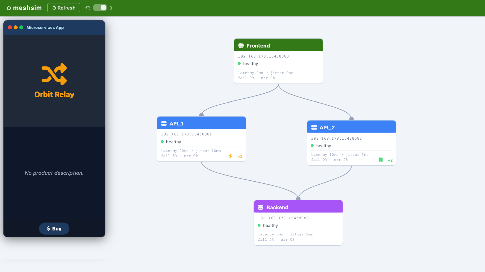

# UI Guide

The meshsim browser interface is a live network diagram that auto-refreshes to show the current
state of the entire reachable topology — including health status, QoS parameters, and optional
application data like quotes, products, and counters.

Open the UI on any running instance:

```
http://localhost:<port>/ui
```

You can open the UI from any node's port — each one renders the full topology as seen from that
node's perspective (what it can reach via its upstream chain).

---

## Screenshot



*The screenshot above shows the **microservices** scenario (without products/quotes loaded) in
dark mode. The Frontend (green) calls API_1 (blue, v1 tag) and API_2 (blue, v2 tag) in parallel;
both call the Backend (purple). The left panel is the WebApp overlay.*

---

## Status bar

The status bar runs across the top of the page and takes the **background colour of the root node**
(the service you loaded the UI from).

| Element | Description |
|---|---|
| **⬡ meshsim** | Application title |
| **↺ Refresh** | Manually trigger a topology fetch and re-render |
| **☀ / ☽ toggle** | Switch between light and dark themes. The preference persists for the browser session. The default follows the OS colour scheme. |
| **Last update** | Timestamp of the most recent successful topology fetch |

---

## Topology canvas

The main canvas displays the topology as a directed node graph. The layout is computed automatically
using a **BFS (breadth-first search) rank** — the root node (the service the UI was loaded from)
sits at the top, and each layer of upstreams appears below.

### Canvas interactions

| Interaction | Action |
|---|---|
| **Drag on empty canvas** | Pan the viewport |
| **Mouse wheel** | Zoom in / out |
| **Drag a node card** | Reposition that node. The position is remembered across auto-refreshes. |

---

## Node cards

Each service in the topology is rendered as a node card (210 × 120 px):

```
┌────────────────────────────────────────┐
│ ■  Service Name              [tag]     │  ← coloured banner with icon
├────────────────────────────────────────┤
│ 192.168.1.10:8081                      │  ← address (monospace)
│ ● healthy                              │  ← status dot (green = ok, red = error)
│ ─────────────────────────────          │
│ latency 20ms · jitter 10ms             │  ← QoS summary
│ fail 5% · err 0%                  [42] │  ← failure/error rates; counter badge
└────────────────────────────────────────┘
```

| Element | Description |
|---|---|
| **Banner** | The coloured strip at the top; colour and icon are set by `color` and `icon` in the config. |
| **Service name** | Set by `name` in the config. |
| **Tag badge** | Optional version/replica label (bottom-right of banner). Set by `tag`, `tag_color`, `tag_icon`. |
| **Address** | The IP:port of the service as detected at startup. |
| **Status dot** | Green = healthy (last request succeeded). Red = errored (last request failed or the upstream was unreachable). |
| **QoS summary** | Shows `latency_ms`, `jitter_ms`, `failure_rate` (as %) and `error_rate` (as %). |
| **Counter badge** | Appears when the counter is > 0. Shows the current counter value; font size scales down for larger numbers. |

### Error state

When a service is unreachable or returns an HTTP error, its node card shows a **red status dot**
and an error message in place of the QoS summary. The rest of the topology continues to render
normally — a single failing node does not abort the whole graph.

---

## Edges

Edges (connections between nodes) are drawn as **cubic Bézier curves** with a filled dot at the
target end. An edge from A to B means A lists B as an upstream and calls it on every `GET /`.

---

## WebApp overlay

The WebApp overlay is a fixed panel on the left side of the screen. It appears automatically
when the topology contains **at least one node with quotes, products, or a counter** anywhere in
the reachable graph.

```
┌────────────────────────────────┐
│ ● ● ●  Microservices App      │  ← fake title bar with traffic-light dots
├────────────────────────────────┤
│                                │
│    [product icon]              │
│    Product Name                │  ← random product from products.txt
│                                │
│    Quote text from quotes.txt  │  ← random quote from the topology
│                                │
├────────────────────────────────┤
│           $ Buy                │  ← triggers POST /count/add
└────────────────────────────────┘
```

| Element | Description |
|---|---|
| **Title bar** | Decorative macOS-style traffic-light dots and the title "Microservices App". |
| **Product** | A random product name and Font Awesome icon drawn from the `products.txt` of any node in the topology. |
| **Quote** | A random quote from the `quotes.txt` of any node in the topology. |
| **Buy button** | Issues `POST /count/add` to the root node's address (the service the UI was loaded from). The counter fans out through the topology until it reaches the node with `counter_enabled: true`. After the request completes, the UI re-renders immediately so the counter badge updates. |

> **Tip:** The WebApp overlay is a demo prop — it simulates a real user interacting with the
> application. Use it in live demos to show the counter incrementing in real time as you click
> Buy, while simultaneously watching the topology for failures.

---

## Auto-refresh

The UI fetches `GET /` from the root node and re-renders the graph on a timer set by
`ui_refresh_secs` in the config (default: 5 seconds).

- The timer is **not stacking** — if the fetch takes longer than the interval, the next fetch
  waits until the current one completes.
- A **manual Refresh** button is always available in the status bar.
- If a fetch fails, a red error banner appears at the top of the canvas. The last successful
  topology remains visible until the next successful fetch.

---

## Light and dark mode

The UI follows the OS colour scheme by default and can be toggled manually with the ☀/☽ button.
Both themes are fully supported — node card colours, edge colours, and the status bar adapt
automatically.

---

## Tips for demos

- **Open multiple tabs** — open the UI from different service ports simultaneously to see the
  topology from different vantage points.
- **Watch the counter** — with `counter_enabled: true` on a backend service, clicking Buy
  increments a badge on that node card in real time.
- **Trigger failures** — in another terminal, stop a downstream service. The node will turn
  red within one refresh cycle. Restart it to watch the graph recover.
- **Drag nodes** — rearrange node positions to match your architecture diagram for a cleaner
  presentation layout. Positions persist across refreshes until you reload the page.
